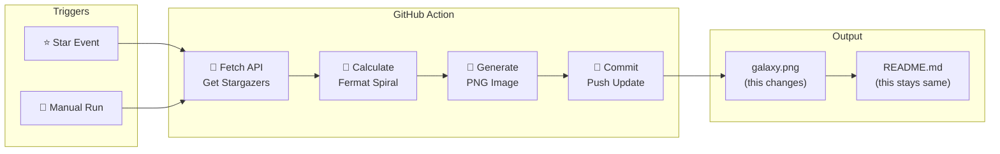

# Stargazer Galaxy

[](https://opensource.org/licenses/MIT)
[](https://github.com/features/actions)
[](https://nodejs.org/)

[← Back to Muripo HQ](https://tznthou.github.io/muripo-hq/) | [中文](README.md)

Turn every stargazer into a star in your project's galaxy.


> ⭐ **Star this repo and you'll appear in the galaxy!**

---

## Features

- **Automated Galaxy Generation**: GitHub Action listens to star events, fully automatic
- **Sunflower Layout**: Fermat spiral with the golden angle, spread as evenly as sunflower seeds — no clumping with a few stars, no overflow with many
- **Permanent Position**: User position determined by GitHub ID, forever theirs
- **Updates Only on Change**: The same stargazers always produce the identical image, so nothing is committed unless something changed
- **Hybrid Glow**: Avatar + colorful glow, 5 colors randomly assigned

---

## Comparison with Other Tools

There are several stargazer visualization tools available. Here's how we compare:

| Feature | **Stargazer Galaxy** | [Repository Roster](https://github.com/varunsridharan/action-repository-roster) | [Repo Roster](https://reporoster.com/) | [Star History](https://star-history.com/) |
|---------|:--------------------:|:-----------------:|:-----------:|:------------:|
| **Visual Style** | 🌌 Sunflower Galaxy | 📋 Table/List | 🔲 Grid Cards | 📈 Line Chart |
| **Display** | Avatar + Glow | Avatar ± Name | Avatar Grid | Statistics |
| **Output Format** | PNG | HTML/MD | SVG | SVG |
| **Update Method** | Action commit | Action edits README | Live API | Live API |
| **Self-hosted** | ✅ | ✅ | ❌ | ❌ |
| **Customization** | High (edit JS) | Medium (params) | Low | Low |
| **Layout Algorithm** | Fermat Spiral (golden angle) | Sequential | Grid | Time Series |

### What Makes Us Different

- **Sunflower Layout**: Fermat spiral with the golden angle, as natural as a sunflower head — not boring grids or lists
- **Seeded Random**: Same person always at the same position, coordinates determined by username
- **Art-focused**: Colorful glow + galaxy background, visual aesthetics over pure functionality
- **Fully Self-hosted**: No dependency on third-party services, data stays in your repo

---

## How Does This Actually Work?

> **Common Misconception**: "README.md generates the image"
> **Correct Understanding**: README.md never changes — what changes is the `galaxy.png` it references

### Complete Flow

```
You Star this Repo
       ↓
GitHub detects the watch event
       ↓
GitHub Action is triggered
       ↓
Action runs generate-galaxy.js
       ↓
Script calls GitHub API to get all Stargazers
       ↓
Fermat spiral (golden angle) calculates each position
       ↓
New assets/galaxy.png is generated
       ↓
Action auto commits + pushes
       ↓
The image in README "appears" updated
```

### Key Point: README Stays Same, PNG Changes

README.md always contains just this one line:

```markdown

```

This line of code never changes. But since the `assets/galaxy.png` file gets updated by the Action, when you refresh the page, the image content changes.

**Think of it like a picture frame**: The frame (README) stays the same, but the photo inside (PNG) gets swapped.

---

## Architecture



---

## Algorithm

### Fermat Spiral (Sunflower Pattern)

A Fermat spiral with the golden angle — the same pattern sunflowers use for their seeds:

```
radius = c × √n
angle = n × 137.5°
```

- `c`: Spacing (`CONFIG.spacing`)
- `n`: Stargazer number (in starring order)
- `137.5°`: The golden angle, which drops each star into the gaps left by the earlier ones

This pattern appears in:
- Sunflower heads
- Pine cone scales
- Daisy centers

Spacing stays roughly even whether there are 5 stars or 150. New stars are added on the outside, so existing stars never move.

Earlier versions used a logarithmic spiral, which clumped together with only a few stars and ran off the canvas past about 47.

### Seeded Random

Each user's slight offset is determined by their username:

```javascript
const rand = seededRandom(username);
const offset = (rand() - 0.5) * 3; // Preserves spiral shape
```

Ensures the same person is always at the same position, even after regeneration.

---

## Tech Stack

| Technology | Purpose | Notes |
|------------|---------|-------|
| GitHub Actions | Automation | watch + dispatch |
| Node.js 22+ | Runtime | ES Modules |
| GitHub API | Data Source | Stargazers endpoint |
| Puppeteer | PNG Rendering | Headless Chrome screenshot |
| HTML/CSS | Layout & Style | Radial gradient glow |

---

## Quick Start

### Local Testing

```bash
# Enter project directory
cd day-19-stargazer-galaxy

# Generate demo version (with mock data)
npm run demo

# Open to view
open assets/galaxy.png
```

### Install to Your Repo

#### Step 1: Copy Files

Copy these files to your repository:

```
.github/workflows/galaxy.yml  → Action config
scripts/generate-galaxy.js    → Core generation script
package.json                  → Dependencies
package-lock.json             → Locked dependency versions (required by npm ci)
.nvmrc                        → Node version (read by the workflow)
assets/                       → Output directory (empty is fine)
```

#### Step 2: Set Permissions

1. Go to **Settings** > **Actions** > **General**
2. Under **Workflow permissions**, select **Read and write permissions**
3. Click Save

#### Step 3: First Run

1. Go to **Actions** tab
2. Find **Update Stargazer Galaxy**
3. Click **Run workflow**
4. Wait ~30 seconds, `assets/galaxy.png` will be created

#### Step 4: Display in README

```markdown

```

---

## Project Structure

```
day-19-stargazer-galaxy/
├── .github/
│   └── workflows/
│       └── galaxy.yml          # GitHub Action config
├── scripts/
│   └── generate-galaxy.js      # Core generation script
├── assets/
│   └── galaxy.png              # Generated galaxy image
├── package.json
├── package-lock.json           # Locked dependency versions
├── .nvmrc                      # Node version
├── README.md                   # Documentation (Chinese)
└── README_EN.md                # Documentation (English)
```

---

## Customization Guide

Open `scripts/generate-galaxy.js` and modify the `CONFIG` object:

### Change Size

```javascript
const CONFIG = {
  width: 800,      // SVG width
  height: 600,     // SVG height
  centerX: 400,    // Center X
  centerY: 300,    // Center Y
};
```

### Change Spacing

```javascript
spacing: 22,  // Spacing (larger = looser; too large and big repos run off the canvas)
```

The default of 22 fits about 170 stars on the 800×600 canvas.

### Change Glow Colors

```javascript
glowColors: ['#58a6ff', '#a371f7', '#f778ba', '#7ee787', '#ffa657'],
// GitHub style: blue, purple, pink, green, orange
```

Want Cyberpunk vibes? Try:

```javascript
glowColors: ['#ff00ff', '#00ffff', '#ff0080', '#80ff00', '#0080ff'],
```

### Change Star Size

```javascript
starSize: 28,  // Avatar diameter
glowSize: 40,  // Glow diameter
```

---

## Notes

### API Rate Limit

- GitHub API has rate limits
- Action uses `GITHUB_TOKEN` for automatic auth (5000 req/hour)
- Very large repos (10000+ stars) may need batch processing

### Action Minutes

- Each star triggers an Action (unstarring does not)
- Free accounts: 2000 minutes/month
- `concurrency` is configured to prevent parallel runs

### Why Commit the Lock File?

The workflow installs with `npm ci` from `package-lock.json`, so every run gets the same package versions instead of whatever was just published to npm. The job has write access to the repo, and install scripts can use it too, so pinned versions keep a hijacked new release from being installed automatically.

Pinning puppeteer also pins the Chrome version it downloads, so the image doesn't suddenly change because Chrome was updated.

To upgrade dependencies, run `npm install` locally to update `package-lock.json` and commit it. To speed up installs (~10-15 seconds), add `cache: 'npm'` to the setup-node step in `galaxy.yml`.

### Anti-Abuse

```yaml
concurrency:
  group: galaxy-update
  cancel-in-progress: true
```

If someone star → unstar cycles, old workflows are automatically cancelled.

### Race Condition Handling

When multiple workflows run simultaneously (e.g., multiple stars at once), push conflicts may occur. The workflow uses `git pull --rebase --autostash` to handle this:

- `--rebase`: Places local commits after the latest remote commits
- `--autostash`: Automatically stashes untracked files like `package-lock.json` generated by `npm install`

This ensures the Action completes successfully even under race conditions.

---

## Privacy Notice

This project uses GitHub's public API to retrieve stargazer information (username, avatar). This information is already publicly visible on GitHub's UI.

**If you don't want to appear in the galaxy, simply unstar.**

The next Action run (when someone stars or the maintainer runs it manually) will remove your position.

---

## Thoughts

### The Shape of Community

Each star is a connection. Someone found it useful, interesting, worth bookmarking, and pressed that star.

These connections accumulate into the shape of a community. The spiral ensures everyone has their own place — no overlapping, no crowding.

### The Aesthetics of the Sunflower

Sunflowers arrange their seeds by the golden angle. Each seed lands in the gaps left by the earlier ones, so the head never gets crowded no matter how big it grows.

We use it to arrange stargazers, giving every supporter a place of their own, growing outward ring by ring into a galaxy unique to this project.

### For Vibe Coders

This project uses Puppeteer to render PNG — because GitHub's SVG security restrictions block external images.

But the core logic is still simple: one spiral formula, one color array, one seeded random. Want different colors? Change the array. Want different layout? Change the formula. Puppeteer just screenshots HTML to PNG.

**Fork it. Break it. Make it yours.**

---

## License

This project is licensed under the [MIT License](LICENSE).
